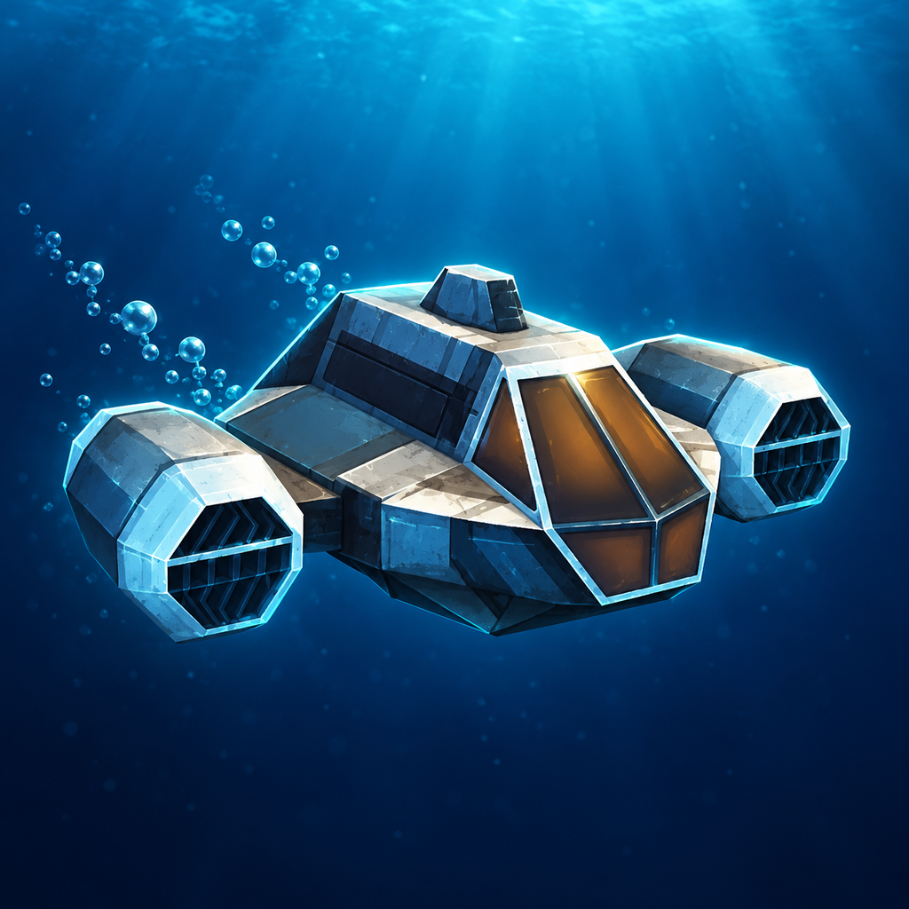
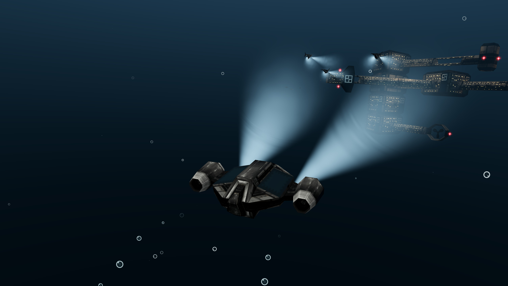
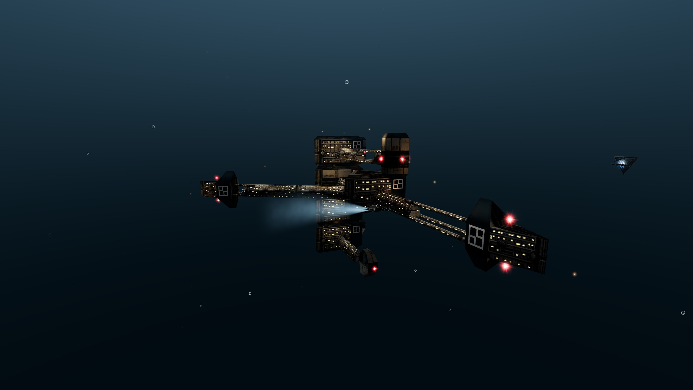
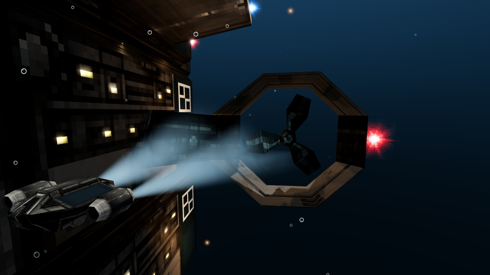
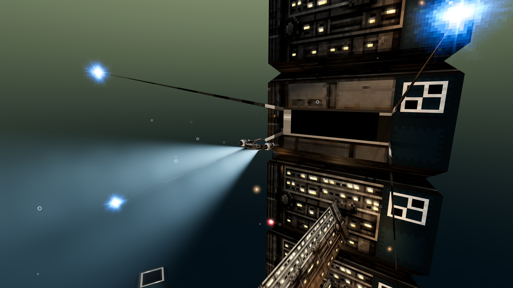
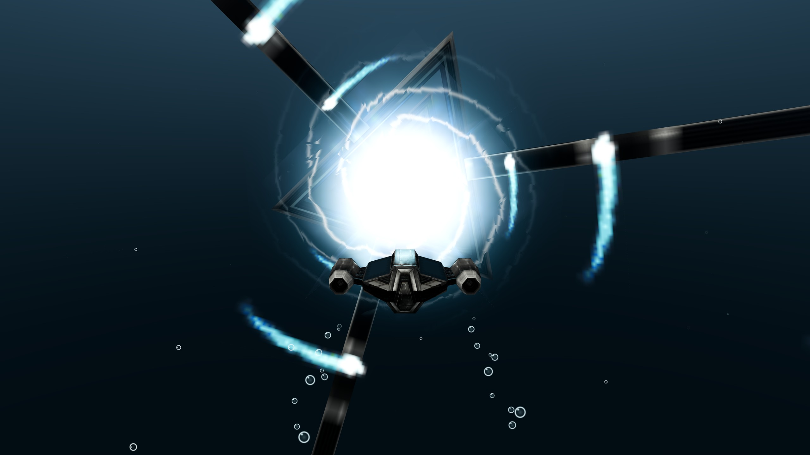

# Abyssal



Play **DEEP** as a modern desktop or browser game, using your own copy of the original.

Abyssal is a separate game engine, built in Godot, that reads a DEEP JAR you already own and converts it on your own machine. Submarine piloting, stations, trading, missions and combat run natively, with modern lighting, gamepad and touch support, a readable interface and a world map with autopilot.

> **You need your own copy of DEEP.** No game data ships with this engine - no models, textures, music, sound or interface art. Nothing is downloaded for you. Without your own JAR there is nothing to play.

## What it looks like

[](https://github.com/TheWWWorm/abyssal/releases/download/v1.0.0/abyssal-engine-1.0.0-screenshot-headlights-off-rygg.png)

[](https://github.com/TheWWWorm/abyssal/releases/download/v1.0.0/abyssal-engine-1.0.0-screenshot-rygg-from-outside.png)

[](https://github.com/TheWWWorm/abyssal/releases/download/v1.0.0/abyssal-engine-1.0.0-screenshot-station-engine.png)

[](https://github.com/TheWWWorm/abyssal/releases/download/v1.0.0/abyssal-engine-1.0.0-screenshot-leaving-the-berth.png)

[](https://github.com/TheWWWorm/abyssal/releases/download/v1.0.0/abyssal-engine-1.0.0-screenshot-stream-gate.png)

Each picture opens at its full 5120x2880. There is also a [one-minute trailer in 4K](https://github.com/TheWWWorm/abyssal/releases/download/v1.0.0/abyssal-engine-1.0.0-trailer-4k.mp4) - stations from outside and in, a departure, a fight, the gate - rendered by the engine itself from a converted copy of the game.

## Play in your browser

**[Play now at abyssal.wwworm.com](https://abyssal.wwworm.com/)** - nothing to install. Open the page, choose your own DEEP JAR, and it converts in your browser. Your JAR is never uploaded; the conversion runs entirely on your machine and the converted content stays in your browser's local storage.

Installation and title preparation show progress. If the game and device languages differ, the language choice appears before the 3D title is built. Reopening checks saved content; an incomplete or damaged import returns to the content picker while keeping expedition saves.

Needs WebGL 2 and a desktop-class browser. For the smoothest experience, and to keep your imported content across browsers, use a desktop package below.

## Reference wiki

**[Open the DEEP reference at abyssal.wwworm.com/wiki](https://abyssal.wwworm.com/wiki/)** - an illustrated wiki of the whole game: the story told in acts, characters, the world, all two hundred stations on the chart, ships and creatures as 3D pictures, equipment, goods, contracts, medals, controls and guides, in fifteen languages. It covers the full story, so it contains spoilers; the in-game [reference](#reference) shows only what your save has reached. The online edition is built from the English release of DEEP and shows its names, descriptions, dialogue and art.

## Download and play

**[Download the latest release →](https://github.com/TheWWWorm/abyssal/releases)**

| Platform | Download | Start |
| --- | --- | --- |
| Windows x86-64 | `…-windows.zip` | `abyssal.exe` |
| Linux x86-64 | `…-linux.tar.gz` | `AbyssalEngine/abyssal.x86_64` |
| Linux ARM64 (AArch64) | `…-linux-arm64.tar.gz` | `AbyssalEngine/abyssal.arm64` |
| macOS Apple Silicon | `…-macos.zip` | `Abyssal.app` |
| Android 8+ (ARM64 / x86-64) | `…-android.apk` | Install the APK, then open **Abyssal** |
| Browser (WebGL 2) | `…-web.zip` | Host the archive yourself, or [use the hosted build](https://abyssal.wwworm.com/) |

Extract the **entire** archive and keep the files together. You do not need Godot, Python, Java, Node.js or a compiler - the desktop and Android packages carry their converter, and conversion runs completely offline.

1. Launch the application.
2. Choose your DEEP JAR when asked, or drag it onto the window. Its filename does not matter.
3. Wait for the first conversion to finish before closing the app.

On Android, allow your browser or file manager to install the APK when prompted. Keep Android System WebView enabled and up to date; it runs the bundled offline converter during the first import. Choose your JAR from the system file picker and keep the app open until conversion finishes. The APK supports 64-bit ARM devices and x86-64 emulators, requires OpenGL ES 3, and requests no network or broad storage permission. Later APK updates preserve content and saves; uninstalling removes them.

The APK automatically selects a bundled converter compatible with the active WebView, including older versions that lack modern JavaScript or WebAssembly exception support. Choose your JAR as usual; conversion remains offline. If the converter cannot start, update the device's active WebView provider through its supported system or app updates and retry. Installing a different browser does not necessarily change the WebView used by the APK.

**Android validation:** a player reported successful gameplay and direct JAR import on a Retroid Pocket 5 with preview.3. Prepared-pack import, native gameplay, touch input, Android Back and reopening saved content were also checked in an Android 15 x86-64 emulator. Direct JAR conversion failed in that emulator because Android System WebView stopped before the decoder started. If direct import fails on another device, update its active WebView provider and retry your JAR.

Your JAR never leaves your device. The game remembers imported content and station checkpoints in your user storage, so you only import once.

### Discord activity

Desktop packages can show Abyssal in Discord, with the current activity and equipped ship: exploring, combat, fishing, autopilot, docking, trading or outfitting a submarine. The activity has a session timer and follows ship purchases. Story titles, dialogue, pilot names and save data are never included.

Keep the Discord desktop app running and enable activity sharing in Discord. **Settings → Gameplay → Discord activity** turns sharing off or back on. The game reconnects if Discord starts later and clears its activity on exit. Browser and Android builds do not connect to Discord.

The [Abyssal application icon](game/ui/abyssal-icon.png) is a square 1024×1024 PNG, also suitable for the Discord application icon and Rich Presence artwork. It is a newly generated, stylized illustration of the Ino submarine in open water. The same artwork appears in the desktop and Android icons, browser and home-screen icons, the reference wiki, and a compact startup splash with **ABYSSAL** underneath.

### Which DEEP builds work

The engine is developed against the **Sony Ericsson release of DEEP 1.0.8**, identified by SHA-256:

`a247f8a872dda268ed8138086bd0de6d038d7faf7ef31469b0efe3eb54209d26`

That is the build all gameplay checking is done on. It is not a requirement. Any DEEP MIDlet JAR is accepted, and the importer converts it whenever the build stores its data the way the engine expects. Localised builds are supported: the language shipped in the JAR is the language you play in.

The engine's own menus, settings and messages follow the game's language when the engine has it, and otherwise the system language. Settings → Display → Language picks one by hand. The engine text is available in English, Russian, Ukrainian, German, French, Spanish, Brazilian Portuguese, Italian, Polish, Turkish, Indonesian, Vietnamese, Simplified Chinese, Japanese and Korean. The story, ship and item names always come from the JAR.

To change the story's language, choose a JAR in that language with matching game data. Existing saves stay loadable when only the text differs; see the save compatibility details below. **Transfer save** exports a backup to keep separately.

Builds that have actually been run through the importer:

| Build | Result |
| --- | --- |
| Sony Ericsson 1.0.8 (English) | Developed and validated against this build |
| Sony Ericsson 1.0.3 (Russian) | Converts; the engine check suite passes on it, and the game is in Russian |
| Sony Ericsson 1.0.2 and 1.0.3 (English) | Convert. Their game data matches 1.0.8, so saves load on any of these Sony Ericsson builds in either language |
| "Deep 3D: Submarine Odyssey (Mascot3D)" 1.0.8, Fishlabs manifest | Converts. It is the same build as the Sony Ericsson release apart from its manifest, but the circulating copy is repacked with its last entry a byte short, which stock ZIP readers refuse. The importer recovers the entry, checks its size and CRC, and produces identical content |
| "Deep 3D Submarine Odyssey" 1.0.8 with `data/3d/*.m3g` | Does not convert, and says so. This is the JSR-184 (M3G) edition of the game: its models are in a different format from the Mascot Capsule (MBAC) builds the engine decodes |
| Nokia 1.0.3 | Does not convert; its code differs in ways the restricted data reader does not cover |

If a build does not match, import stops with a message naming what did not fit, rather than producing a broken game.

The title screen's bottom line names the imported build after the engine's version, such as `DEEP 1.0.8 EN`, from the JAR manifest's version and the game's language; **About → Original** adds the start of the JAR's hash. Content imported by an earlier version shows the start of the hash in place of the version until the JAR is imported again.

## Before you download - please read

- **Windows and macOS have never been run on their native systems.** They are built and packaged, but not tested on real hardware. Both are unsigned and macOS is not notarized, so those systems may warn about or block them.
- **macOS is Apple Silicon only.** Intel Macs cannot run this build.
- **Linux x86-64 and Android** have local rendering checks; see the release’s `VALIDATION.md` for the exact checks and hardware limits.
- **Linux x86-64 and Windows** start on Vulkan and fall back to OpenGL 3.3 without one; the Graphics page's Forward+ options (volumetric light, shading detail, temporal antialiasing) only take effect on Vulkan.
- **Linux ARM64** requires a 64-bit ARM Linux system and working OpenGL 3.3 or OpenGL ES 3.0 drivers. Native ARM Linux execution and gameplay are not yet verified. The archive is a desktop export; PortMaster handhelds require additional launcher and runtime integration, and compatibility depends on the device and firmware.
- **The browser build needs a web host.** Opening `index.html` from your disk will not work.
- **Android** is a sideloaded APK. From 1.2.0 it starts on Vulkan (Godot's Mobile renderer) and falls back to OpenGL ES 3 on a device without a usable Vulkan driver. Physical ARM64 hardware performance is not yet verified; Android validation uses an x86-64 emulator without a GPU, so the Vulkan path has only been built, not run.

## Controls

| Action | Keyboard / mouse | Gamepad (Xbox labels) | Touch |
| --- | --- | --- | --- |
| Steer | Mouse, Up / Down pitch | Right stick | Left thumb stick, or drag any free area |
| Strafe left / right | A / D | Left stick left / right | Left thumb stick, which turns by default |
| Throttle | W / S | Left stick up / down | Slide along the arc round GUNS |
| Guns / harpoon | Left / right mouse (harpoon also F) | RT / LT | Hold GUNS / HOOK |
| Selected weapon / switch weapons | Space / Tab | RB / D-pad left | GUNS or HOOK |
| Boost | Shift | LB or left stick click (L3) | Hold BOOST |
| Dock / STREAM gate | E | A | DOCK (shown when in range) |
| World map / autopilot | M / R (hold R for objective) | View (Back) / X | MAP / ROUTE |
| Time: 1×/2×, autopilot to 16× | T | D-pad up / down | TIME |
| Camera / lights | C / L | Y / D-pad right | Pause menu / Settings → Graphics |
| Look around the hull | Hold Alt or Ctrl, move the mouse | Hold the right stick in, move it | - |
| Save (docked) | F5 | - | Pause menu |
| Pause / back | Escape | Start / B | Pause / Back |
| Menus | Arrows / Enter | D-pad or stick / A | Tap |
| Auto fire / fullscreen | Q / F11 | - | Hold weapon / Pause menu |

The gamepad column is the **Standard** layout. **Settings → Controls → Gamepad → Button layout** switches to **Classic**, the layout of earlier releases (D-pad throttle, A selected weapon, X switch weapons, Y dock, LB autopilot, RB time, D-pad left camera and held to look).

**Settings** is one screen, the same from the main menu, the pause menu and a station's System menu, with five tabs: **Audio**, **Graphics**, **Display**, **Controls** and **Gameplay**. LB / RB switch tabs. **Controls** opens **Steering**, **Gamepad**, **Touch controls**, **Key bindings** and **Control reference**; leaving one puts the highlight back on the row that opened it. Between them they offer keyboard remapping, mouse sensitivity and inversion, tilt steering, controller deadzone and inversion, touch look sensitivity, Touch **Auto / On / Off**, touch control placement, and left/right handling as **Auto / Always strafe / Always turn**. **Gameplay tips & control hints** (Settings → Gameplay) hides loading tips, one-time M.A.I. guidance and the control reminder; objectives and action prompts remain visible. **On-screen messages** below it has separate switches for messages at sea (autopilot, time speed, camera, arrival and auto-fire confirmations; refusals and warnings still show), dock and gate prompts, the autopilot status line and friendly contact labels. Only the most recently used controller steers the submarine. The game pauses if a controller disconnects or the window loses focus. In the browser it also pauses if the page gives your pointer back, which is what pressing Escape there does.

Every key in the table except Escape can be changed under **Key bindings**; Escape always opens the menu and cancels a binding, so the game cannot be left without a way out. A key added to the list by an update takes the first free key if a saved layout already uses its default. **Menu navigation** in the same list sets four keys that move through menus alongside the arrow keys and D-pad; they may repeat steering keys, so WASD can steer at sea and move through menus at a station. Ctrl looks around too while that action keeps its default Alt and no other action is bound to Ctrl.

**Look around** by holding Alt (or Ctrl) and moving the mouse: the chase camera swings around the submarine instead of steering it, right and left, over and under, and eases back behind the hull when the key is released. The reticle hides until the camera returns; shots fire straight ahead while you are looking around.

**Mouse wheel throttle**, under Settings → Controls → Steering, is off by default. When enabled, scrolling up or down changes the speed by 25%, and **S** stops forward motion immediately, cancels boost and disengages autopilot. With this option off, **S** lowers throttle by 25% per press; holding it continues lowering throttle to a stop, with gradual deceleration. The same key can be rebound under Key bindings, where it appears as **Stop** with wheel throttle on and **Throttle down** with it off. **W** increases the throttle. The wheel continues to scroll menus normally. Gamepad and touch retain their speed controls.

Notices at sea show up to three recent messages together. Each fades in for two seconds and out for two seconds; repeated messages leave the fade running. Radio dialogue has a **Back** button to reread earlier lines before continuing. **Player profile** and its medals view show the portrait chosen for the expedition.

The flight display reads as the original's does. Stations, gates and autopilot marks carry their name and range; ships get a bracket and a hull bar but no caption. A combat radar (level 2 or 4) shows a picture of an enemy's cargo once it is in the middle of the view, and a fishing radar (level 3 or 4) shows a creature's picture and its weight there, as the original does. A wreck or crate a mission asks you to recover shows the salvage or recovery picture. Without a fishing radar fish are not marked at all, except the school a mission asks you to protect. When the hull is damaged its percentage stays beside the gauges, and while pressure is crushing the hull the warning bar shows what is left of it. The depth countdown starts once a departure or S.T.R.E.A.M. exit shot has finished. The helm strip shows the harpoon's reload beside the booster; on a touchscreen the fire and harpoon buttons fill as they reload, the fire button following the slowest gun. Past a depth limit, the original's 3D arrow stands ahead of the submarine until it is back inside its limits, pointing straight up or down towards safe water in the colour of that limit (the original shows it only more than 200 past the limit, and aims it at the limit's panel, so it could turn about as the camera passed the limit first). An enemy keeps its bracket and hull bar right up to the screen's edge, and they move with it through a turn. Money is written with the original's gold coin wherever the imported coin is available; the coin keeps its own colours in coloured text. A creature killed in the water leaves the original's red cloud. While a mission set in the current area is under way, the station turns you away, as the original's does.

**Helm response**, under Controls · Steering, is **Direct** by default: the original's response, with the full rate the instant a key goes down, none the instant it comes up, and the mouse turning the hull one step per pixel. **Smooth** eases the submarine into a turn over a fraction of a second and out of it when the key or stick is released, and holds the mouse to three times the hull's own steering rate, so the steering upgrades in the shop count for a mouse pilot too. Either way the hull leans into a turn as the phone game's does: over in about a third of a second, held while the helm is over, and back upright over a couple of seconds once it centres. (Before 1.2.2 the hull snapped level the instant the helm was released.) The reticle stays at screen centre. **Auto fire** (Q) works the guns and never the harpoon. **Original weapon controls**, under Settings → Controls and off by default, brings back the original's single fire control for the selected weapon bank: Tab changes bank, and auto fire waits while the fishing bank is selected and opens up again when the guns are. Fire held down through a bank switch waits for a fresh press, so switching to the harpoon mid-burst never looses it. While auto fire is on, the reticle turns amber and its outer marks turn while the guns fire. The chase camera looks at the point 204.8 m straight ahead of the submarine, keeping that centre on the hull's line of fire. Shots and the harpoon converge on whatever the reticle rests on, and in open water on that point. The front and side cameras have no reticle, and the weapons fire straight ahead in them, as the original always did.

**Manual roll**, under Controls · Steering, is off by default. Switched on, **Z** and **X** roll the submarine left and right about its own length (both can be rebound under Key bindings), and a gamepad stick axis can be given the **Roll** role in Gamepad. The hull then stays at the angle you leave it instead of levelling itself when the helm is idle, and the chase camera rolls with it. Roll turns at 1.5 times the hull’s normal steering rate, including steering upgrades. The autopilot still flies level.

**Steer by tilting**, under Controls · Steering, steers the submarine by tilting a phone or tablet. It reads the device's own motion sensor, so a desktop machine has nothing to offer it, and a browser asks permission the moment you switch it on. Tilt turns; it never strafes, and the stick and touch controls keep working alongside it. **Calibrate tilt** makes your current grip the neutral position, and **Tilt sensitivity** sets how far you have to lean for a full turn. The browser reads tilt in the visible screen's orientation and recentres after the display rotates or the sensor pauses. (The Android build before 1.2.1 never asked the phone for its sensors, so tilt reported no reading there.)

Changing a setting keeps the highlight on the row you changed, so a long list stays usable on a gamepad. Actions that cannot be undone - reloading a checkpoint, leaving for the main menu, abandoning a contract - ask before they act.

In menus, use the D-pad or left stick to move, **A** to select and **B** to go back. Dropdowns use the same controls; left/right adjusts sliders. In Touch **Auto**, using a keyboard, mouse or gamepad hides the touch controls until the screen is touched again. Controller drift and browser mouse events generated by a touch gesture do not switch the controls, including on iPhone Safari. **On** and **Off** remain manual overrides.

A and D, and the gamepad left stick, slide the submarine sideways rather than turning it. Turning is the mouse, or the right stick. On a touchscreen the thumb stick keeps turning instead, because a thumb has nothing else to turn with. **Left/right keys and stick** in Settings → Controls → Steering overrides that choice on any platform. Lateral thrust runs at a fraction of cruise speed and ignores the throttle, so a stopped submarine can still slide out of trouble, and it counts as manual control: strafing disengages an autopilot course.

On touch controls, the submarine levels while steering and the chase camera keeps the water upright during ordinary turns. Diagonal thumb movement can still pitch and yaw together without rolling the entire view.

Lists and menus scroll by dragging anywhere inside them, not only on the narrow scroll bar. A short tap still selects the row under your finger; once the finger has clearly moved the gesture becomes a scroll and the row is not activated. The atlas keeps its own pan and pinch.

The station menus are glass panels over the docked station: the six services as tiles, the hangar, missions and status as cards with the game's own pictures, and the shops as a list beside a detail panel with the item's figures and the purchase. The ship dealer compares your hull with the one for sale, and the equipment shop's ship line opens the ship and cargo page. A destination outside the hull's safe depth is not refused: as in the original, the chart warns that it lies outside the safety zone and asks whether to travel there. Every STREAM transfer asks for confirmation, on the chart and again at the gate, and the dock key asks before docking.

On a touchscreen the stick appears wherever your left thumb lands and returns to its resting corner when you lift off; **Settings → Controls → Touch controls → Steering stick → Fixed in place** keeps it where it is placed instead. Dragging any free area of the screen swings the camera round the submarine without steering it. The camera stays where you left it until you touch the stick again or a few seconds pass. **Invert vertical steering** applies to the stick, the drag and the mouse. On a widescreen phone the interface keeps a margin on both sides, clear of the notch or camera cutout whichever way the phone is turned; held upright it keeps clear of the notch and status bar at the top and the home indicator at the bottom. The view behind it still fills the screen. Held upright, controls and text keep the size they have in landscape, the harpoon sits above the guns and the booster above the stick, and the camera widens its view (about 50° across instead of 32° on a 19.5:9 phone) rather than showing a narrow slit of what is ahead. The touch HUD shows hull and armour, shield, cargo, credits and station in the top left, pause and map in the top right, and a short depth gauge covering the hull's safe band. Armour is drawn in yellow while it lasts; once it is gone the same bar shows the hull in green. The throttle is an arc round the guns button: slide along it to set the speed. **Settings → Controls → Touch controls → Throttle → Separate slider** puts it on an upright bar of its own above the button instead, clear of its rim, so setting the speed never fires and firing never changes it; held upright, the harpoon then sits beside the guns. Buttons for a harpoon, guns or booster appear only when one is fitted, and a ship without guns has its harpoon in the guns' place. Double-tap the guns button for automatic fire; its rim stays lit and shows **AUTO**. Tap once to stop. The harpoon has no automatic fire. With **Original weapon controls** on, the screen shows one fire button for the selected bank and, in the harpoon's place, a button that switches bank; double-tapping the fire button turns on auto fire for the guns. Opening a menu clears automatic fire; a radio message only pauses it, and it resumes when the message closes. The booster button refills from the bottom while it recharges. DOCK appears, pulsing, only when there is a station or gate to dock with. The camera view and fullscreen are in the pause menu. On a desktop the same gauges are used: condition, cargo, credits and station in the top left and the depth gauge on the right, whose ends take the colours of the depth-limit panels (gold above the safe band, deep blue below it), with thrust, time and the booster on a strip at the foot of the screen; the booster half appears only when one is fitted. **Settings → Display → Retro HUD** adds the original game's gauges in the same style: the cargo hold as a bar across the top, and along the foot of the screen the shield and hull bars either side of the auto fire, autopilot and hull lamps. Those bars take over from the top-left gauge rows, armour again in yellow while it lasts, and a damaged hull's percentage shows above the hull lamp. iPhone browsers have no fullscreen control: open the game in Safari, use Share → Add to Home Screen and start it from that icon to play without browser bars (other iOS browsers cannot add it). Where a browser does offer fullscreen, the button in the top-right corner of the main menu and pause menu, and the pause menu entry, switch it; the entry is dropped once the game already runs without browser bars.

The Android app follows the device's rotation in every direction, so a phone held upside down in a controller clamp shows the picture the right way up. **Settings → Display → Screen orientation** can fix it to **Landscape** or **Portrait**. The main menu is laid out upright on an upright phone, in the browser too.

On the world map, tap a station, drag to pan and pinch to zoom. With a mouse, right-drag and scroll. With a controller the left stick moves the zone, LB / RB step through the stations in the side view, and LT / RT zoom. The map opens on the reticle: the D-pad moves it, A selects the area, then the D-pad chooses a station and A confirms the destination. The station list is searchable too. **Back** is in the top-right corner, leaving more room for translated actions along the bottom. Station names sit directly beside their markers. Crowded names are omitted until there is room; zoom in, hover a marker with the mouse, or select a station to read its name. The selected station's name is always shown, and hovering a name already on the chart does not repeat it. The selected name is highlighted, and mission destinations get priority. In the side view, the water above 20000 takes the colour of the selected station's region, the colour of its most common alga, as the sky over it does. **Range on chart**, on the map's **SPECIES** page, rings every station where a species you have caught lives: the most common in the widest ring. **Algae** shows all five algae at once, and **Deselect** clears the rings.

Touch players can select **Settings → Controls → Touch controls → Touch look area → Whole screen** to drop the stick: a drag anywhere then steers as the mouse does. **Touch look sensitivity** applies to the drag in both modes; action buttons retain their own touch targets. Select **Outside analog area** to restore the stick.

**Settings → Controls → Touch controls → Adjust control placement** moves and resizes the on-screen controls. Every control is named while you edit, and the selected one shows its size. Drag a control to move it, tap one to select it and resize it between 60% and 200%, and reset one control or all of them. The editor panel starts wherever it covers nothing, and you can drag the panel itself if it is still in your way. You are dragging the real controls, not stand-ins; the throttle arc follows the guns, and the separate slider follows them too until you move it yourself. **Mirror fire control**, on the same Touch controls settings page, puts the throttle on the right of the button for a layout with firing on the left, and the choice is saved. Default positions keep clear of notches and rounded corners, but controls can be dragged into those screen margins if preferred. A placement is stored as an offset from where the standard layout puts that control, so rotating the device or playing on another screen keeps the arrangement and only moves what you moved.

## Playing

The title menu stands in front of the station of your save - the one you will return to, or the first one of a new game - with the camera circling it and the game's own music playing, as the phone game shows it. A new game opens on the original's title sequence: the camera coming in on the station over a minute while the imported title cards go by, with its two sonar pings and its music. Enter, a click, a tap or the pad's A button skips it. Starting or loading a game shows a notice while the water is built.

The new-game screen builds the captain's portrait from the JAR's own parts. **Male** or **Female** picks the set; beside the portrait, a row of arrows each steps the skin tone, hair, eyes, chin, suit and accessory, layered in the original's order. As in the original, which draws each part of the face apart, every hair, pair of eyes and chin goes with every other: 1,668 men's faces (8 × 12 × 17 light-skinned and 3 × 3 × 4 dark-skinned with the English JAR), before suits and accessories. The 300 women's faces come from the set the original keeps for its crew. **Generate face** draws one at the original's odds, and **Import image** takes a picture of your own, cut to the original's 40 × 40 square and kept in the save.

**Settings → Audio → Menu and opening music** picks the title and opening track. **Auto** plays the track the JAR's own build uses: intro.mid for 1.0.3 builds, station.mid for 1.0.8. **Intro** and **Station** force one. Docked, station.mid always plays. Auto needs content imported with 1.7.0 or later; older imports play station.mid until the JAR is imported again.

The dock keeps the original Hangar, Missions, Map, Trade, Status and System grouping, and shows each station's ownership and tech level. Hangar holds the equipment shop and ship dealer; Trade has the market and the workshop on two tabs, as the original's Trade screen did, with the goods in your hold at the top. As in the original, the station's stock is on the left and your hold on the right: each cargo line gives the station's stock, the price range and the tonnes in your hold; the arrow beside each moves one tonne across, and **Sell all** and **Buy all** move the whole lot (as much as your credits, hold and the station's stock allow); Status holds your ship, cargo and pilot record. Station names stay visible at sea, and quest destinations get gold labels and off-screen direction markers.

Objectives that count discoveries, completed contracts or other progress have no fixed destination. Their journal entries show progress without a station or an autopilot action, and the chart and on-screen markers show destinations only for travel, encounters and deliveries. A separate accepted contract keeps its own destination while a story counter objective is active. A timed job, such as junk removal, shows the time left under its objective and fails when it runs out.

**Settings → Gameplay** holds the world spacing and the S.T.R.E.A.M. gates. **World spacing**, also on the new-game screen, sets how wide one square of the chart's grid is: Short (10 km), Medium short (15 km, the default), Normal (25 km), High (50 km), Original (471 km) or Custom (at least 10 km). A square is 25 map units, so these are 400 m, 600 m, 1 km, 2 km and 18.85 km per unit. Actual distances follow the stations' map positions; this value is not a minimum gap between stations. Original uses the original game's 18.85 km distance conversion. Changes apply on the next departure or when loading a save. Ship and station sizes, depths, contracts and which destinations S.T.R.E.A.M. can reach stay the same. Target labels use metres below 1,000 m and kilometres from 1,000 m onward.

**S.T.R.E.A.M. gates** are separate by default, as in the original: a transfer comes out of the station's IN gate, which closes behind the ship, and the next transfer leaves from its OUT gate. The Shared option merges the two into one portal used both ways. Gate changes apply from the next area entered. The chart draws the last six areas visited as a fading line of recent trips.

Trading moves an amount rather than a tonne at a time: set **AMOUNT** with its − and + steps, or press **Max** for as much as the purse, the hold and the station's shelf allow, then Buy or Sell in one press. Each button offers only what it can actually move, and reports what it actually moved.

An active local encounter locks the OUT gate until it is resolved, including combat side jobs, as in the original. Opening and cancelling the gate chart preserves your throttle setting.

Going into a gate is seen from the cockpit. Coming out is shown from outside: the submarine leaves the far aperture at full ahead, easing back to the speed you were travelling as the camera hands back. You always come out on the side the region is on, heading in towards it, whichever side you entered from. Steering stays yours throughout. Fire, Enter, a click or a tap skips the exit camera and restores your cruising speed, just as Fire skips a station departure.

A S.T.R.E.A.M. transfer planned on the map takes you to the gate and crosses to the chosen station as soon as it opens. Steering into a gate without a transfer plan lets you choose a destination there: press the dock key to open **MAP**, with the discovered count in its heading. Choose an exit in range from the list, or pick one off the chart. **NAVIGATE** reads out who holds the station, its tech level and depth alongside the distance and your reach; **SPECIES** lists the species that live there, the most common first, and which of them you have already caught.

The map opens on its movable reticle. Arrows or the D-pad move it; Fire, Enter or A selects the area. All four directions then cycle through the stations inside it, and Fire confirms the selected destination. Escape or B returns to moving the reticle. Tab reaches search and the route buttons.

Mission-journal navigation and the objective shortcut use S.T.R.E.A.M. for remote destinations within engine reach, local navigation for the current area, and continuous travel for stations beyond reach. Map search also offers an explicit choice of continuous autopilot or a STREAM transfer. Pressing the autopilot control while it is engaged immediately returns manual control. As in the original, a course change eases onto the new heading in a couple of seconds whatever the hull, slowing as the nose comes round, and keeps the horizon level; hull handling and steering upgrades govern your own steering. Flying into a station turns the hull away from it at the original's gentle rate rather than spinning it round. Time acceleration runs ordinary simulation ticks - T cycles 1×/2× under manual control and up to 16× during clear autopilot travel, dropping back to 1× near danger or on arrival. Autopilot passes stations vertically within your ship's pressure limits, steers around their modules on approach, and, as in the original, docks as soon as it enters the station's docking area - where the dock key works - or touches its hull. It lines up on the hangar door only when the door is on its way in, so a station is never rounded to reach it. Taking manual control keeps the destination: the autopilot menu (R) offers to resume the route until you arrive. An active encounter must still be completed before docking. As in the original, the story turns the ship away from Gosu in the fifth chapter, and from everywhere but Gosu in the sixth.

The water is the phone game's water. Twenty creatures of the local habitat swim around you wherever you go - anything the camera leaves four hundred metres behind is set down three hundred metres out again, ahead as readily as behind, and brought in out of the haze over a couple of seconds the way a streamed station is, so there is always something to catch and the water ahead of a traveller fills - the station's own ships go their rounds past the gates, and from the twelfth chapter on there is a growing chance of pirates waiting ahead. Each story chapter fields the encounter the original stages for it: the minefield of chapter 23, the five freighters of 29, the boss fights, the finale with its own camera shots; contracts are laid out by their kind with the original's numbers. Every creature keeps its keel down; the JAR's creature models are all built the other way up from its hulls and stations, and each is turned over to be drawn. The two-part creatures - the anglerfish, devilfish, marlin and their kin - bend at the join between head and body as they swing, rather than turning the head whole on the body's origin as the phone does, which opened a wedge into the hollow between them; and the head is placed from the body as drawn, so it no longer trails the body by a step while the fish swims (before 1.2.2 both showed as a gap at the neck). Ships fight as the original's do, harpooned creatures run and fight with their own strength and are lost the moment they leave the screen, the harpoon line is the original's see-through beam in the colour of the harpoon fitted (yellow, amber or red), a harpoon reloads for as long as its line can fly (four seconds for every harpoon in the original) and starts reloading again when a line comes free, so pressing the harpoon again to let a catch go is never followed straight away by another shot, wrecks sink and can be hooked for salvage, mines arm within thirty metres and go off two seconds later, supply capsules rise toward the surface and are launched again from the station.

Markets are stocked and priced as the original stocks them: up to four lines of goods that come more readily the nearer their home, two to five pieces of equipment gated by rarity and chapter, up to three hulls, the special holdings that sell everything, and the imports that come in between visits; goods are worth more the further they are from home. The equipment store opens on **Shop**, which lists systems for sale; **Ship Equipment** lists installed systems. Both show the current and maximum equipment slots; **Ship and Cargo** shows those limits too. The job board posts one to eight offers of the kinds each side gives, fees and deposits on the fifty, each with the client's face, the destination's depth and distance and a difficulty. **Check location** opens the chart at an offer's destination, and **Back** returns to the board. Colonists do not trade: they take whatever is in your hold at its floor price when you dock, and pay a bounty on the pirates you have sunk that grows with the square of their number. Rebel holdings keep your cargo for trading and making goods. The tutorial chapters keep the original's locks, the job board opens at the ninth chapter and the chart at the seventh, and a complete medal collection buys the Aquarius for 50,000. Every random draw comes from the game's own generator, in the original's order.

The phone game's Help is here: **Help** in the title, pause and System menus opens its Instructions, ten topics of the imported text, its Controls and its Credits. The loading screen carries one of its Tips & Tricks. M.A.I. says her one-time pieces the first time their moment comes - the gate, the dock, radiation and pressure, the booster she wants, the catch that got away, the hold that is full - and remembers them in the save, so loading or updating does not start them again. **Gameplay tips & control hints** under Settings → Gameplay turns all of those optional tips off. The station cards of the collection are still shown when they are earned. There are three save slots and the autosave, chosen on Load and on Save game at a station. **Load game** in a station's System menu loads any of them without returning to the main menu, and leaves the autosave as it was. A catch or salvage notice names what went into the hold and its weight in tonnes. With the hold full, a catch, a fish carcass or a salvage crate stays in the water until there is room (the original spent carcasses and crates that did not fit). A radio exchange keeps the water still from its first line to its last, with no movement between one speaker's window and the next. Damage to the shield, armour or hull buzzes a pad or a phone (Controls · Gamepad · Vibration), flashes the screen edges red and shakes the view; a hit the shield or armour absorbs shows more lightly than one that reaches the hull. As in the phone game, a drop in hull percentage blinks **HULL nn%** for three seconds in its red pixel lettering from the JAR, and at a quarter of the hull or less the screen edges pulse red. Each of these has its own switch under Settings → Gameplay → Damage feedback. A lost hull explodes and its debris sinks before **Game over** offers the station checkpoint; a failed or finished encounter likewise waits for the explosion that ended it. A hull left on its back rolls itself upright once the helm is released, as the phone game's does, and the water outside a berth keeps moving while you are at the station. Every menu page has one way back: the BACK in its corner, Esc, or B on a pad.

Stations are assembled as the original assembles them: each grows from its own seed as a tree of the imported modules - a hangar of either kind at the root, bridges, engines, starters and side habitats one socket step apart, habitats stacked above and below with bottom, top or cannon caps, and the emblem frames of whichever faction holds it. Their silhouettes match the phone's station for station.

Classic instruments work with either classic or enhanced lighting, and both use the original models and textures. Modern lighting derives hull relief, roughness and warm window masks from your own imported textures at runtime; the source textures and silhouettes are preserved. **Station texture smoothing** and **Ship texture smoothing**, in Settings → Graphics, independently choose filtered or pixelated surfaces in either lighting mode. Both start pixelated. Larger replacement atlases use their own pixel grid: magnified texels stay crisp, while details smaller than a screen pixel are filtered to avoid flicker. Original-size atlases retain their original sampling. Both choices apply immediately, including to nearby vessels and distant stations, and are saved between launches.

The enhanced options in **Settings → Graphics**: **Headlights** follow each original hull’s beam geometry: its number of lamps, their positions and their direction (L at sea). The emitters sit at the centres of the visible lamp openings, or on the hull surface where the source model has no separate lens. **Headlights** has four modes: **Off** removes the lens glow, surface illumination and beams; **Light only** keeps the lit lenses and surface illumination; **Light + beams** adds cones in the water that stop at hulls and station walls; **Classic** restores the original textured beam geometry and colours without the added light. The choice applies to the player and other vessels. L switches it off and restores the previous mode. Existing headlight preferences are preserved when upgrading. **Headlight colour** applies to Light only and Light + beams; Classic retains each original colour. **Volumetric light** is the glow of station lamps in the water, **Surface shading detail** the ambient occlusion in the station's crevices; both need the Forward+ renderer. **Lamps** (since 1.2.2): every lamp sprite of the original - the red and blue glows on station engines, habitats, hangar berths and mines - now casts a real light immediately around it, from where the sprite has always been; the sprite itself is unchanged. The lures of the anglerfish and gulper eel are the exception: theirs are drawn as a point of light, a soft halo the size of the sprite, because a crossed sprite on a swinging head read badly; the point rides the tip of the rod as the head bends (in 1.2.2 it stayed on the unbent rod, and sat up to a metre beside the tip while the fish swam). All of this is part of enhanced graphics; the classic renderer keeps the sprites alone. **Depth limit markers** (Settings → Gameplay), off by default, draws a faint hatched panel, about the hull's size, below or above the submarine as it approaches its deepest or shallowest safe depth in **Near limits** mode, with four times the former warning distance - the engine's version of the phone game's limiter panels, which are too small a texture to show at that range. **Always** keeps both panels in view, as the original drew them, sized to stay readable however far away they are. **Temporal antialiasing** (Settings → Graphics) needs it too: the Linux and Windows builds start on Vulkan and use it, and fall back to OpenGL on a machine without a Vulkan device, where those three rows say so and do nothing. Android runs the Mobile renderer on Vulkan (falling back to OpenGL ES); the browser has only WebGL 2 in this Godot, and the macOS and ARM Linux builds run on OpenGL.

**Action freeze** in the pause menu holds the game still and hands you the camera: orbit, pan and zoom around your submarine, hide the panel for a clean view, then resume exactly where you left off. An on-screen bar carries every action, including **Back to pause** and **Resume**, so it needs no keyboard; Escape and the pad's cancel button also leave. Nothing is simulated or saved while frozen.

Hits show the direction they came from as arcs around the centre of the view, so an attacker behind you reads as behind you.

**Load game** on the main menu includes **Import save…** and **Export save…**, even before the first save exists. Import restores a portable save into the autosave slot; Export lets you choose an existing manual slot or autosave. The same transfer is available through **Transfer save** in the pause menu and a station's System menu. An export is a small data-only file: it contains the save and never the game content, which each device imports from its own JAR. An export loads only on a copy that imported the same JAR or one that differs from it only in text, and importing keeps the save it replaces as a backup. If a save is ever damaged, the game falls back to that backup and tells you it did.

**Settings → Display** offers a picture **Aspect ratio**: **Auto** fills the window, and **4:3**, **16:9**, **16:10** or **21:9** pin the picture shape and letterbox the rest.

In the water the game's music stops, as it does in the original; every ten seconds one of the four ocean cues plays instead, at a volume of its own. Weapon audio follows the original cue table: harpoon launch and attachment, towing, vessel explosions and creature deaths use their matching imported effects; ordinary gunfire and generic impacts are silent. Creatures move as the phone game moves them - the manta's flap, the jellyfish's pulse, the tail wags and body wander of each species - a closed S.T.R.E.A.M. gate turns slowly on its axis, a moored mine rocks in place, and a harpooned catch shrinks into the hull as the line shortens.

As in the original, the water above takes the colour of the most common alga around the current station - deep blue, magenta, gold, green or rust - fading towards black below 15000. Between stations of different algae it shades from one colour into the other across the water, and after a gate it changes over a few seconds. Classic shows the colour as the phone did; enhanced graphics gather it overhead above the water's own navy horizon, so the hue tints the scene without filling it, and the filtered sunlight and light columns take the same hue. **Water colour**, under Ocean atmosphere, sets how strongly: 0% is plain blue water everywhere, 60% (the default) a muted tint and 100% each region's own colour at full strength. The light on every model dims with depth on the original's curve, so climbing out of deep water visibly brightens the scene; both Classic and enhanced graphics follow it. Enhanced graphics use the imported sky palette for the sun opening and for soft columns of filtered light that stay in place in the water as the vessel passes through them, under slowly drifting veils of haze. With volumetric light, banks of suspended matter also lie between the camera and distant hulls, stations and creatures. Depths are darker where local lamps carry more of the light. Headlights follow each original model's lamp count, mounting points and direction. Their origins attach to the hull surface, and their light colours nearby surfaces and marine snow. Lamp lenses and the openings in framed lamp grilles use the beam's colour independently of the cabin lighting. Submarine cockpit panes combine smooth reflections with soft, uneven interior illumination and a small, shadowed spill close to the window. Regional water takes restrained hues from the original plankton palette and origin stations, with smooth transitions and small changes in haze and suspended matter. Each region keeps its alga's own hue at any strength, so golden water stays gold rather than green, and the algae themselves keep their pigment under the blue water light and the headlights. Content imported by an early build has no palette, so its water would be a neutral blue everywhere; play waits until it is brought up to date. On a computer the game imports the remembered JAR again by itself, or opens the file picker if the JAR has moved; on Android it opens the picker; in a browser the title asks you to choose the JAR. Saves are kept. A compatible build whose JAR has no palette plays with neutral water. Marine snow drifts in gentle currents and streaks along the water's movement past the camera: outward from the centre of view when cruising or boosting, sideways when the current or a sideways slide carries it, and not at all when still. Headlight beams brighten and dim as they pass through thicker and thinner banks of suspended matter that drift with the current, and the snow they light follows the same banks. Occasional patches of bioluminescence glow briefly as the hull passes, and the jellyfish's luminous tissue pulses softly. A vessel explosion leaves a rising bubble cloud and sinking fragments after its short flash. The soft rays, regional blending and depth response are enhanced presentation effects; they do not change fishing, combat, detection ranges or pressure limits.

**Settings → Graphics** opens with a **Preset**: **Classic**, **Low**, **Medium**, **High** or **Very high**. Classic is the original lighting; the others are the enhanced lighting with the settings below. A preset sets shadow quality, volumetric light and surface shading detail; changing any of those afterwards shows **Custom**. Antialiasing, upscaling, frame generation, resolution, the ocean effects, headlight mode and colour, and texture filters are left as chosen. Antialiasing can be changed independently without switching the preset to Custom. On the first start with game content, the title measures the device on its station seen close up, as at sea, drawing about a third more pixels than the preset will as room for the submarine, its lights and the interface, and picks the highest preset from Low up that holds 60 frames a second; the list marks it **(Recommended)**. A recommendation from an earlier version of this measurement is measured again, and a preset still set to it is replaced. A graphics setting changed by hand before then is kept, and so is Classic lighting chosen in an earlier version. Settings with several choices open a list.

| Preset | Shadow quality | Volumetric light | Shading detail |
| --- | --- | --- | --- |
| Low | Off | Off | Off |
| Medium | Low | Off | On |
| High | Medium | On | On |
| Very high | High | On | On |

**Performance** holds those settings and **3D resolution**. **Shadow quality** decides how many station lamps cast shadows at once: the ones the camera is nearest, on screen; the rest light without a shadow. On OpenGL (browsers, phones) that is 4 work lamps and 4 small sprite lamps at **High**, 2 and 2 at **Medium** and 1 work lamp at **Low**, because OpenGL draws everything a shadowed lamp reaches once more for it; on Vulkan it is 14 and 8, 8 and 4, and 4 work lamps, with Medium and Low using two hemispheres instead of six faces, where a little light can pass close to a lamp. Station lamps take their shadows from the station only, so their shadow maps are drawn once and kept; the submarine's shadows come from its headlights and the overhead light. **Off** removes all shadows, including the headlights' and the overhead light's. Phones and browsers keep smaller shadow maps at every level. **3D resolution** draws the 3D view at 100% down to 33% of the display resolution; 67%, 58%, 50% and 33% are the Quality, Balanced, Performance and Ultra performance shares of FSR 2. **Upscaling** (since 1.17.0) picks how a 3D view below 100% is scaled up: **Bilinear**, **AMD FSR 1.0** (the default, as before) or, on Forward+, **AMD FSR 2.2**, which reuses earlier frames, replaces temporal antialiasing and also smooths edges at 100%. **MetalFX spatial** and **MetalFX temporal** (the temporal one works like FSR 2.2) are listed only when the engine runs on Apple's Metal driver, which none of the current builds use (the macOS build is on OpenGL). FSR 1.0 also works on Android's Vulkan Mobile renderer; OpenGL builds scale bilinearly and show the row as unavailable. **AMD FSR 3.1**, **AMD FSR 4** and **Frame generation** are offered by the Windows package on Direct3D 12 (see [AMD FSR on Windows](#amd-fsr-on-windows)); stock Godot has none of them. **Multisample antialiasing** is Off, 2×, 4× or 8×. The default is 4×; 8× reduces shimmer along model outlines at a higher GPU cost while keeping texture detail sharp. Ship and station previews follow the same choice and use temporal antialiasing when it or a temporal upscaler is selected for the main view, while keeping their own native resolution. **Renderer** (since 1.21.2, on Windows, Linux x86-64 and Android) picks the renderer for the next start: **Vulkan**, the default, or **OpenGL**, the compatibility renderer the browser build uses, for a graphics driver that draws Vulkan wrongly; OpenGL has fewer enhanced effects and the rows that need Forward+ say so. The Windows package also offers **Direct3D 12 · AMD FSR** (see [AMD FSR on Windows](#amd-fsr-on-windows)). The first start on another renderer is a trial: if the game closes unexpectedly within its first minute, or that renderer cannot start, the next start goes back to Vulkan and the title says so. The choice is kept in `renderer.cfg` in the game's user folder; deleting that file also goes back to Vulkan. A machine without a usable Vulkan device already starts on OpenGL, and the row then reads **OpenGL · Vulkan unavailable**.

**Settings → Display** has **Resolution**, native or a lower height (720p to 2160p, below the screen's own), which the 3D view is drawn at; the interface stays at the screen's resolution. **Show FPS** puts the frame rate at the top of the screen.

**Headlight brightness**, under Enhanced lighting, dims the headlights from 100% down to 20%: the light on surfaces, the visible beams and the marine snow they catch, for the player and other vessels.

**Enhanced lighting** groups lamps, beam colour, cabin lights, warm station lights, cool ambient light and filtered sunlight. **Ocean atmosphere** contains volumetric light, deep-water darkness, regional water, marine snow, bioluminescence and explosion aftermath. **Surfaces and textures** contains shading detail and the two texture filters. All effect switches start enabled; ship and station texture smoothing start off. Changes apply immediately and are saved between launches. Classic preserves the Enhanced choices for the next switch back.

**Warm station lights** gives the station lamps and windows an amber light. Switched off, they take the pale cream of the original's window texels.

**Cool ambient light** gives ambient and overhead illumination a blue-green tint inspired by the promo artwork. It can be switched independently of the amber cabin lighting; imported hull textures, local work lights, shadows and depth attenuation stay intact.

**Headlight colour**, on the same page, offers **White** (the default) or **Blue** from the original beam texture. It changes regular headlights, their lenses and cast light together, including other vessels. Aquarius retains its original red headlights in both modes. The choice applies immediately and is saved between launches.

Campaign and radio content comes from your local JAR. Saves from 1.1.1 and earlier load; their random draws continue from a fresh seed of the game's generator. A save stays loadable when its JAR is replaced by a translated or reworded copy: saves record the JAR's game data without its text (`.lang` strings, name lists, station names and the text fields of its code) and load on any JAR whose remaining data matches. The Sony Ericsson 1.0.2, 1.0.3 and 1.0.8 builds share saves this way. Saves from 1.16.0 and earlier record only the JAR's file hash; they load on a reworded JAR if the original JAR's import is still in the content folder.

### Reference

**Reference** is an illustrated encyclopedia of your own imported game; a full, spoiler-complete edition is online at [abyssal.wwworm.com/wiki](https://abyssal.wwworm.com/wiki/). Open it from the pause menu, a station's System screen, or **Help** on the main menu. It covers the story as a plot summary told in acts, the characters' biographies, the world (the ocean, the colony, the Aquarians, the S.T.R.E.A.M. network and more), every station with its tech level, depth, species and trade, the colonists, rebels and pirates, ships, equipment, sea creatures, goods and recipes, story chapters, characters, job board contracts and medals, and guides to the controls and station screens, depth, travel, fishing, trade, combat, fitting, contracts and medals, with a page of tips.

Each page pairs the game's data with the reference's own writing: overviews, synopses, biographies and guides, written for this project in every interface language. The language menu in the reference's header switches its own writing and labels to any interface language. Names come from your JAR when the reference is in the JAR's language and from the reference's own name lists otherwise; item descriptions, dialogue and the game's own help and loading tips are shown in the JAR's language only. The figures follow the engine's rules. Each chapter page summarises the chapter and lists who appears in it; the full briefing, radio calls and debriefing are on the chapter's linked dialogue page. Ships, creatures and stations turn as 3D models beside their page (drag to turn them; creatures are drawn whole, head or tail joined and swimming as they do in the water), ships and creatures with the game's own sprite below, and stations with their place on the station chart below; equipment, goods, medals, contracts and characters show their imported art and portraits, and chapters the chart as it stood then. Nothing is downloaded and none of the game's own content is bundled.

The story stops where you are. In a game it ends at the current chapter; from the main menu, at the furthest chapter any save has reached. Later chapters, characters you have not met, stations that have not yet changed sides and anything the written pages say about later events stay out of every page, and the current chapter's ending appears once you finish it.

Search finds pages by name. Links move between pages, ◀ and ▶ (or Alt+Left and Alt+Right) go back and forward, and **Linked pages** lists a page's links for a controller. On desktop, **Save as web page** draws a picture of every ship, creature and station and writes the reference, with its pictures and every language (switchable in the page's header), into the user data folder's `reference` folder and opens it in your browser; it works without a server or connection and stays on your machine. Its header links to this repository and to the browser version of the game.

**About**, on the main menu, has two tabs. **Original** shows the about text, copyright and credits from your imported game. **Remake** links to this project's source code, website, reference and author, and names the graphics technologies a package includes.

### Reconstructed textures

After importing a compatible JAR, or on the first launch with an existing import after this feature is installed, the game offers **Reconstruct and enable** or **Not now**. The same choice is available at **Settings → Graphics → Surfaces and textures → Reconstructed textures**.

Reconstruction draws sharper hulls, station panels, markings, creatures and effects, plus shallow normal-map relief. It uses the imported atlases and a fitted vector/material recipe. It preserves the original atlas layout; it is a restoration, not a lossless recovery of missing pixels. Surface relief is visible with Enhanced lighting.

The first run shows progress and a Cancel button. It can take a minute or more on slower devices. The result is saved privately on the device, separately for each imported JAR. Enabling it again reuses the completed cache. Disabling it returns to the original textures immediately. Custom colour and normal uploads take priority; a custom colour atlas does not inherit reconstruction's normal map. Incomplete, damaged or outdated generated sets are rebuilt when reconstruction is enabled. The imported originals and saves are kept.

The game ships the renderer and its fitted recipe, not generated PNGs. The recipe contains artwork-derived contours and material parameters; see [texture reconstruction provenance](provenance/texture-reconstruction.md). Generation runs locally in Godot on desktop, Android and the browser, without Python, downloads or a separate texture-pack installation.

### Mods: how to replace textures, music and models

Nothing is shipped as a mod; the game reads a `mods` folder you make yourself, and whatever it finds there stands in for the imported art or music. Collision, aim and the camera keep the imported models' extents, so a mod changes the look and sound, not the game.

**Where the folder goes.** Either next to the executable (`AbyssalEngine/mods/` beside `abyssal.x86_64` or `abyssal.exe`; beside the `.app` on macOS), or in the user data folder, which every build reads (on Android and in the browser that folder is the app's own private storage, so use the title screen's Mods page there):

- Linux: `~/.local/share/abyssal-engine/mods/`
- Windows: `%APPDATA%\abyssal-engine\mods\`
- macOS: `~/Library/Application Support/abyssal-engine/mods/`

**Textures, from the title menu.** **Mods → Textures** on the title screen lists the two atlases the game is drawn from, each shown as painted and as the see-through polygons see it, with what stands for it now and **View**, **Replace…** (a PNG from your device, through the system file picker - on Android too) and **Remove replacement**; on desktop it also opens the mods folder and the folder of the imported originals. A replacement applies at once. Everything below is the same thing done by hand.

**Textures.** Put a PNG at `mods/textures/deep.png` or `mods/textures/fx.png` to replace that atlas (a `.bmp` works too). `deep` carries the submarines, stations, mines, torpedoes, boxes and the gate; `fx` the creatures, algae, shots, explosions and effects. Any size works: a 4x or 8x repaint is drawn at more pixels per texel, but keep the original's layout, because every model addresses the atlas by the original's texel positions. One file does both kinds of polygon: where the original sees through a polygon its atlas is pure white - the phone's transparent palette colour - and the engine keys pure white (or your PNG's own transparency) out on those polygons itself, so leave see-through areas white or transparent and use no pure white elsewhere. The originals to paint over are `deep.bmp.png` and `fx.bmp.png` in your content cache (`user data folder/content/<hash>/data/textures/`, or **Open original textures** on the Mods page); a cache imported before 1.2.1 also holds a raw `.bmp` and a `.alpha.png` per atlas, which the game no longer reads. The skybox atlas is not offered: this engine does not draw it - the water is its own sky, reproducing the original skybox's shading over the regional colour.

**Normal maps.** Under **Mods → Textures**, each atlas has a separate **Import normal…** button, preview and **Remove normal** action. Select a PNG; it is installed as `deep.normal.png` or `fx.normal.png` and applies immediately, including with the original colour atlas. Colour and normal maps can be removed independently. On desktop, files can also be copied into **Open mods folder**; restart after copying files outside the game. Use an OpenGL tangent-space normal map (+Y toward the top of the image), with the same atlas layout and a flat colour of RGB `(128, 128, 255)`; any resolution works. Enable **Enhanced lighting** to see shallow surface relief, including on animated parts. Opaque normal-map texels replace the relief inferred from colour; transparent texels retain it.

**Music, from the title menu.** **Mods → Music** lists the JAR's two tracks - `intro` (the menu and a new game's opening) and `station` (docked) - with what plays for each now and its length, and **Listen**, **Replace…** (an OGG Vorbis, MP3 or WAV file, through the system file picker - on Android and in the browser too) and **Restore original**; on desktop it also opens the mods folder and the folder of the converted originals. A replacement plays at once, looped from start to end, wherever the converted MIDI would have played. Done by hand, put the file at `mods/music/intro.ogg` or `mods/music/station.ogg` (`.mp3` or `.wav` work too; the file's content decides its format, not its extension). A 1.0.8 JAR has no intro track; a replacement adds one, which plays when **Settings → Audio → Menu and opening music** is set to **Intro**. The converted originals are `intro.mid.wav` and `station.mid.wav` in `user data folder/content/<hash>/data/sound/`. Files up to 64 MiB are accepted.

**Models.** Put a glTF at `mods/models/<name>.glb` (or `.gltf`) to replace the model of that name. The model is scaled uniformly to the imported model's longest extent and centred on it, so orient it the way the original faces in the content inspector on the title screen. If the file carries animations, the first one loops; the imported skeletal poses are not applied. The names:

- Submarines: `u0` to `u10`, in dealer order.
- Stations: `station_hangar_ve`, `station_hangar_de` (the two hangar roots), `station_habitat_ve`, `station_habitat_de`, `station_sidehabitat`, `station_starter`, `station_top`, `station_bottom`, `station_engine`, `station_bridge_01`, `station_bridge_02`, `station_cannon`.
- Creatures: `shark_01`, `shark_02`, `whale_01`, `whale_02`, `marlin_01`, `marlin_02`, `devilfish_01`, `devilfish_02`, `anglerfish_01`, `anglerfish_02`, `squid_01`, `squid_02`, `shrimp_01`, `shrimp_02`, `turtle_01`, `turtle_02`, `gulper_eel`, `jellyfish`, `manta`, `nautilus`, `fish_swarm`, `alga_blue`, `alga_brown`, `alga_gold`, `alga_green`, `alga_red`.
- Vessels and objects: `tanker1`, `aquar`, `kapsel`, `box`, `biowaste`, `trash`, `mine`, `torpedo`, `pfeil` (the harpoon), `laser_0` to `laser_11` and `laser_aqua` (the shots), `explosion`, `fischtod`, `eclipse`, `limiter_up`, `limiter_down`, `stream` (the gate), `skybox`.

Replacements are read when the game starts, so restart after adding or changing a file. Distant streamed stations keep the imported models until you are close. A file the game cannot read is reported once in the log and the imported model is used instead.

## Browser version

Extract the whole Web ZIP to an HTTPS host, keeping `importer/` and the notices in place. JAR hashing needs a secure context, so use HTTPS (`localhost` also qualifies). The export includes a `_headers` file, so any static host that reads it serves WebAssembly as `application/wasm` and caches content-hashed game packs correctly without extra configuration.

### Publish it on Cloudflare

`public/` holds a ready-to-serve copy of the exported Web build and `wrangler.toml` describes it, so Cloudflare deploys straight from this repository with no build step of its own:

1. In the Cloudflare dashboard, create a Worker and connect it to this repository.
2. Leave the build command empty. `npx wrangler deploy` reads `wrangler.toml` and uploads `public/` as static assets.
3. If your Worker uses a different name, change `name` in `wrangler.toml` to match.

Cloudflare rejects any asset over 25 MiB, and Godot engine binaries exceed that limit. `tools/prepare_web_host.py` splits oversized files into numbered parts, and `worker.js` streams them back together under the original path. The parts stay uncompressed on purpose: Cloudflare negotiates its own `Content-Encoding` for the response and strips one set by the Worker, so pre-compressed bytes would reach the browser undecoded. The release archives keep whole files, so they stay portable to hosts with no size limit. Game packs and engine runtimes have separate content-based URLs; rebuilding only the engine also refreshes its JavaScript and WebAssembly together.

To refresh the hosted build after a new export:

```sh
python3 tools/export_game.py --platform web --release --output /outside/repo/builds/web
python3 tools/prepare_web_host.py --source /outside/repo/builds/web --output public
git add -A && git commit -m "Web build" && git push
```

Browser saves and content live in IndexedDB for that exact origin. Changing the port or hostname creates separate storage, and clearing site data, private browsing or storage eviction can lose it. **Keep your JAR** so you can reinstall. Cloud sync is not implemented; use **Transfer save** to move progress between devices. Low-memory browsers may need a prepared content pack instead of live conversion.

The first import loads roughly 12 MiB of extra runtime files; later launches read the installed content.

## Project status

This is **release 1.21.11**. The project's provenance is not a clean-room one, as this section explains, and that question is unresolved.

The importer recognizes compatible JAR structure, computes a SHA-256 identity for isolated caches, then decodes its resource entries and reads class-file data tables with a **restricted bytecode evaluator**. That evaluator reads literal assignments, arrays, arithmetic and bounded control flow, resolving calls only through explicit inert data summaries; unsupported opcodes fail. It never loads or invokes original classes in a JVM, and no original bytecode or method body is written to its output.

It does, however, inspect and evaluate parts of original method bodies. Because some content is derived that way, this is reverse engineering and **not** a clean-room reimplementation. Decoded models, textures, audio, catalogue rows and narrative records exist only in your own local cache - none are distributed here.

This engine's own source is licensed under the [Apache License 2.0](LICENSE.md). That covers the engine code and original application artwork in this repository. It grants you no rights to the original DEEP game, its JAR, its class files or anything converted from them; those are not this project's to license and are not distributed here. The three vendored decoder files keep their own Apache-2.0 notices, listed in [THIRD_PARTY_NOTICES.md](THIRD_PARTY_NOTICES.md).

Content you convert is private. Do not redistribute it with the engine, and never share the JAR, a converted pack or a conversion cache.

The name is a working title, not a trademark claim. Menus and instrument frames are drawn in code; original logos, portraits and icons are loaded locally from your own import.

## For developers

Requires Godot **4.7 Standard** with matching export templates, and Python 3.10+. Run everything from the repository root and keep builds and game content outside it.

The optional [station rendering patch](engine/godot-4.7/station-rendering.patch) targets Godot 4.7-stable, commit `5b4e0cb0fd279832bbdd69fed5354d4e5ad26f88`. It reuses unchanged cube shadow faces, groups shadow-atlas copies in both Forward+ and Mobile, and avoids lighting work with zero contribution. OpenGL can also evaluate several shadowed station lamps in one material pass while keeping its per-light colour conversion. Animated materials, skinned meshes and meshes using view-dependent LODs retain ordinary shadow rendering. Retained Vulkan shadow cubes use a 256 MiB cache budget; textures needed by the current frame remain alive until their atlas copies finish.

These engine changes require a matching custom export template. The game source also works with stock Godot, which receives the shared station shader improvements but has no engine shadow cache. Build and select a Linux template as follows:

```sh
git clone --depth 1 --branch 4.7-stable https://github.com/godotengine/godot.git /build/godot
git -C /build/godot apply "$PWD/engine/godot-4.7/station-rendering.patch"
# In /build/godot, with Godot's Linux build dependencies installed:
scons platform=linuxbsd arch=x86_64 target=template_release production=yes
# Back in this repository:
python3 tools/export_game.py --platform linux --release --output /outside/repo/builds/linux \
  --template /build/godot/bin/godot.linuxbsd.template_release.x86_64
```

`--template` selects a custom Linux, ARM64 Linux, Windows, macOS or web template without enabling a vendor SDK. Use the template for the chosen architecture and release/debug build type. Release packaging accepts repeated `--template PLATFORM=PATH` arguments, for example `--template linux=/build/godot/bin/godot.linuxbsd.template_release.x86_64`. Windows builds with AMD FSR use `--windows-template` and `--fsr-sdk` instead, with both patches applied as shown below. A new template must be rebuilt for each target platform; selecting an Android native library does not change a desktop or browser build.

For portable Linux releases, use the matching [Godot Buildroot SDK](https://github.com/godotengine/buildroot/releases/tag/godot-2023.08.x-4) to preserve compatibility with older glibc versions. Release 1.21.6 uses SDK `godot-2023.08.x-4`, which targets glibc 2.28. Extract it to a path without spaces, run its `relocate-sdk.sh`, add its `bin` directory to `PATH`, and pass its prefixed `CC`, `CXX`, `AR` and `RANLIB` tools to SCons. The x86-64 prefix is `x86_64-godot-linux-gnu`; ARM64 uses `aarch64-godot-linux-gnu` with `arch=arm64` and `--platform linux-arm64` when exporting. Check the resulting binary's required glibc versions before distributing it.

The browser uses the same optimized OpenGL renderer through WebGL 2. With Emscripten 4.0.11 activated, build a single-threaded web template from the patched Godot checkout, then select its ZIP when exporting:

```sh
# In /build/godot:
scons platform=web target=template_release threads=no production=yes
# Back in this repository:
python3 tools/export_game.py --platform web --release --output /outside/repo/builds/web \
  --template /build/godot/bin/godot.web.template_release.wasm32.nothreads.zip
```

The rendered regression check needs a window and no game content. Run it with an editor built from the patched engine, or a template built with `disable_path_overrides=no` to enable `--path` and `--script`:

```sh
/path/to/patched/godot --path game --rendering-method forward_plus --script ../tests/shadow_cache_render_check.gd
/path/to/patched/godot --path game --rendering-method gl_compatibility --script ../tests/shadow_cache_render_check.gd
```

```sh
# All player packages, including the offline desktop and Android importers:
python3 tools/package_releases.py --version 1.0.0 --output /outside/repo/releases/1.0.0
# A single unpackaged export (windows, linux, linux-arm64, macos, web, android):
python3 tools/export_game.py --platform linux --release --output /outside/repo/builds/linux
# A standalone ARM64 Linux package:
python3 tools/package_releases.py --platform linux-arm64 --version 1.0.0 --output /outside/repo/releases/arm64
```

`package_releases.py` builds the Windows package from the FidelityFX template when given `--windows-template` and `--fsr-sdk` (see [AMD FSR on Windows](#amd-fsr-on-windows)); without them it uses Godot's stock template, whose Renderer row offers Vulkan and OpenGL only.

Builds fetch and verify pinned runtimes once into an external cache (`~/.cache/abyssal-engine` on Linux, `~/Library/Caches/abyssal-engine` on macOS, `%LOCALAPPDATA%/abyssal-engine` on Windows; override with `ABYSSAL_CACHE_HOME`). No JAR is needed to build. Pass `--godot /path/to/godot` or set `GODOT_PATH` if it is not on your PATH.

Discord uses public application ID `1561821965210222642`, configured in `game/project.godot`. In the [Discord Developer Portal](https://discord.com/developers/applications), set that application's name to **Abyssal**, upload `game/ui/abyssal-icon.png` as its application icon, and add the same PNG under **Rich Presence → Art Assets** with key **abyssal**. No bot, token, client secret or player login is required for this local Rich Presence connection. Renamed forks can set `discord/application_id` to their own application ID; `ABYSSAL_DISCORD_APPLICATION_ID` overrides it for local testing.

The desktop helper `desktop/discord_presence.js` uses only Node's built-in modules and the importer runtime already bundled with each desktop package. Running from source requires Node on PATH, or an executable path in `ABYSSAL_NODE_PATH`. Activity updates are coalesced and sent at most once every 15 seconds; disabling sharing and exiting clear immediately. `node --test tests/discord_presence_check.js` checks IPC framing, retries and cleanup against synthetic local peers.

The approved artwork is `game/ui/abyssal-icon.png`. `node tools/generate_branding.js` regenerates the Windows ICO, macOS ICNS, browser sizes and startup splash without changing that master. This development tool needs the `sharp` Node package and DejaVu Sans for the splash title. Install tooling outside the repository; `ABYSSAL_SHARP_PATH` can point to that installation's `sharp` package. Generated branding assets are included in the source allowlist. Every web export stages them automatically, including browser installation metadata; private wiki exports carry their own application favicon.

ARM64 Linux exports can be built from an x86-64 development machine using the matching Godot `linux_release.arm64` template (`linux_debug.arm64` for debug exports). They bundle a separate, checksum-pinned ARM64 Node.js converter. On systems exposing OpenGL ES instead of desktop OpenGL, launch `./abyssal.arm64 --rendering-driver opengl3_es`. The build includes both desktop and ETC2/ASTC texture formats. A successful cross-export does not establish handheld performance or PortMaster support.

Engine text is marked with `tr("...")`, with the English text as the key. Catalogs live in `game/native/locale/<code>.gd`. After changing marked text, run `python3 tools/engine_text.py check`. It lists every missing, stale or broken entry, and `engine_text.py write <code> <file.json>` merges translations into a catalog. After the Chinese, Japanese or Korean catalog changes, regenerate their glyph subsets with `engine_text.py fonts <NotoSansCJK-Regular.ttc> <harfbuzz-subset.wasm>`. This needs Node and the `harfbuzzjs` package.

To run from source with direct JAR conversion you also need JDK 17+ and FFmpeg:

```sh
python3 tools/run.py --jar /private/path/deep3d.jar --compatibility
python3 tools/serve_web.py --directory /outside/repo/builds/web --port 8060   # local web testing
```

### AMD FSR on Windows

The Windows package adds AMD FSR 3.1 and FSR 4 upscaling and frame generation through AMD's [FidelityFX SDK](https://github.com/GPUOpen-LibrariesAndSDKs/FidelityFX-SDK) 2.3.0. Stock Godot 4.7 has neither, so the package runs a Windows template built from Godot 4.7-stable (commit `5b4e0cb0fd279832bbdd69fed5354d4e5ad26f88`) with `engine/godot-4.7/amd-fsr.patch`, the FidelityFX integration. The package shows AMD's FSR marks on the splash screen and in **About**, with AMD's attribution in the credits.

The SDK needs Direct3D 12. The game starts on Vulkan, as every other desktop build does, and loads none of AMD's runtime. **Settings → Graphics → Performance → Renderer** switches to **Direct3D 12 · AMD FSR** from the next start; only this package offers that choice. Like any renderer change, the first start on Direct3D 12 is a trial that goes back to Vulkan if it fails.

On Direct3D 12, **Settings → Graphics → Performance → Upscaling** offers what the graphics card supports. **AMD FSR 3.1** runs on recent AMD, NVIDIA and Intel cards. **AMD FSR 4** needs a Radeon RX 7000 or newer and comes with the [DirectX Agility SDK](https://devblogs.microsoft.com/directx/directx12agility/) runtime in the package's `x86_64` folder.

Their quality follows **3D resolution**. 100% is native antialiasing, 67% Quality, 58% Balanced and 50% Performance. Below 50% they still draw at 50%, since the integration is used from native to Performance. They replace temporal and multisample antialiasing.

**Frame generation** appears with them. It works with FSR 3.1 on most of those cards; FSR 4's own frame generation needs Windows 11 and a Radeon RX 9000 or newer, and FSR 4 upscaling otherwise pairs with FSR 3.1's. Frame generation adds one generated frame per drawn frame while flying and stops in menus, on pause and when the window loses focus. The FPS counter counts drawn frames. The generated frames have no separate interface layer, so interface edges may show artefacts.

The runtime also needs the [Microsoft Visual C++ x64 runtime](https://learn.microsoft.com/en-us/cpp/windows/latest-supported-vc-redist/). Every option reports unavailable, and the game keeps its own upscalers, wherever the runtime, the GPU or Direct3D 12 is missing.

```sh
git clone --depth 1 --branch 4.7-stable https://github.com/godotengine/godot.git /build/godot
git -C /build/godot apply "$PWD/engine/godot-4.7/amd-fsr.patch"
git -C /build/godot apply "$PWD/engine/godot-4.7/station-rendering.patch"
python3 tools/prepare_fsr_sdk.py --output /build/fidelityfx --engine /build/godot
# In /build/godot, with a Windows (MSVC or MinGW) toolchain and Godot's usual Direct3D 12 dependencies:
scons platform=windows arch=x86_64 target=template_release production=yes use_fsr_sdk=yes
python3 tools/export_game.py --platform windows --release --output /outside/repo/builds/windows \
  --windows-template /build/godot/bin/godot.windows.template_release.x86_64.exe --fsr-sdk /build/fidelityfx
```

`prepare_fsr_sdk.py` downloads the pinned FidelityFX SDK files from AMD's GitHub repository and the Agility SDK from NuGet. It checks every SHA-256, and the engine checks the AMD DLLs' hashes again before loading them. The export copies the runtime files and their license terms (`licenses/amd-fidelityfx/`, `licenses/microsoft-directx-agility/`) beside the game; keep them together. None of these runtime files are part of this repository.

### Building Android

Install Godot 4.7 and its matching Android build template (`android_source.zip`), JDK 17 or newer, and the Android SDK versions required by that template. Configure the Java and Android SDK paths in Godot’s editor settings. The Gradle build and pinned importer dependencies are downloaded at build time into external caches; the installed app converts entirely offline.

```sh
python3 tools/export_game.py --platform android --output /path/outside/source/android
```

This creates a debug APK. To publish a release APK, set `ABYSSAL_ANDROID_KEYSTORE`, `ABYSSAL_ANDROID_KEY_ALIAS`, and `ABYSSAL_ANDROID_KEY_PASSWORD`, then add `--release --version 1.0.0 --version-code 21`. Keep the signing key outside the source tree, back it up securely, and reuse it for updates. Increase `--version-code` for each release. `GODOT_TEMPLATES_PATH` can override the export-template directory. Release packaging accepts `--platform android` and includes Android by default; `--validation` supplies a platform support document.

To include the station engine optimizations, apply `engine/godot-4.7/station-rendering.patch` to the same Godot source revision, install its optional frame-pacing dependency with `python3 misc/scripts/install_swappy_android.py`, and build `scons platform=android target=template_release arch=arm64`. Build `arch=x86_64` as well for a package covering both ABIs. Pass `--android-native-libs /build/godot/platform/android/java/lib/libs` to either export or release packaging. The exporter replaces the matching native libraries in the official Android template while preserving its Java code and importer. Use `target=template_debug` for a debug APK; an ABI omitted from that directory keeps its official runtime.

The Android build stages a small Java plugin into Godot’s official Gradle template. A private Android import process shows conversion progress and returns to the game when finished. Android System WebView runs the same Python data reader and procedural audio converter used by the browser and desktop packages. All converter files are bundled in APK assets, all network requests are blocked, and gameplay remains native Godot. License inventories are bundled under `assets/abyssal-importer/` inside the APK.

### Private content tools

For development and private content testing, the desktop packages can prepare a portable `.abyss` pack with their bundled converter; no additional runtime installation is needed. From the extracted package, run the command for the computer's platform, replacing the two absolute file paths:

```sh
# Linux x86-64
./importer/bin/linux/node importer/import.js "/path/to/DEEP.jar" "/path/to/private.abyss"
# Linux ARM64
./importer/bin/linux-arm64/node importer/import.js "/path/to/DEEP.jar" "/path/to/private.abyss"
# macOS Apple Silicon
"./Abyssal.app/Contents/Resources/importer/bin/macos-arm64/node" "./Abyssal.app/Contents/Resources/importer/import.js" "/path/to/DEEP.jar" "/path/to/private.abyss"
```

```powershell
# Windows PowerShell
.\importer\bin\windows\node.exe .\importer\import.js "C:\path\DEEP.jar" "C:\path\private.abyss"
```

These packs contain converted game assets and remain private. Ordinary Android play imports the JAR directly.

Checks and packaging:

```sh
python3 tools/check.py --cache '/path/printed/by/import' --godot '/path/to/godot'
python3 -m unittest discover -s tests -p 'test_*.py'
python3 tools/audit_provenance.py
```

To write the reference of a converted game as a web page folder, for example to check a localized JAR, run this with the folder printed by the import, and keep the output outside the repository, since it holds that game's text. `--chapter=N` stops the story there. Without `--headless` the tool also opens a window to draw the ships, creatures and stations; headless, those pages keep the imported pixel art:

```sh
godot-4 --headless --path game --script ../tools/export_wiki.gd -- '/path/printed/by/import' '/path/to/reference'
```

Packaging reads the explicit allowlist in `source-manifest.json`, checks that the Java bridge stays clear of the original game's class loading, and rejects unexpected files, symlinks and disguised binaries. A per-file review record is kept with the working tree and is not distributed. None of this infers legal ownership.

Prepared archives are attached to [releases](https://github.com/TheWWWorm/abyssal/releases) rather than committed, which keeps this repository small.

See also [third-party notices](THIRD_PARTY_NOTICES.md) and [license status](LICENSE.md). Each release carries its own `VALIDATION.md` recording what was actually executed for that build.

## Donations
If you want to support this development or ones similar to it, you can do it here https://ko-fi.com/wwworm
Please only do it if you have money for it and always be financially responsibe. Nevertheless I am grateful for any support given.
