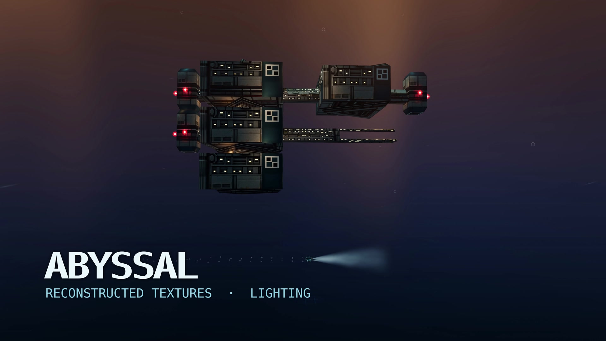
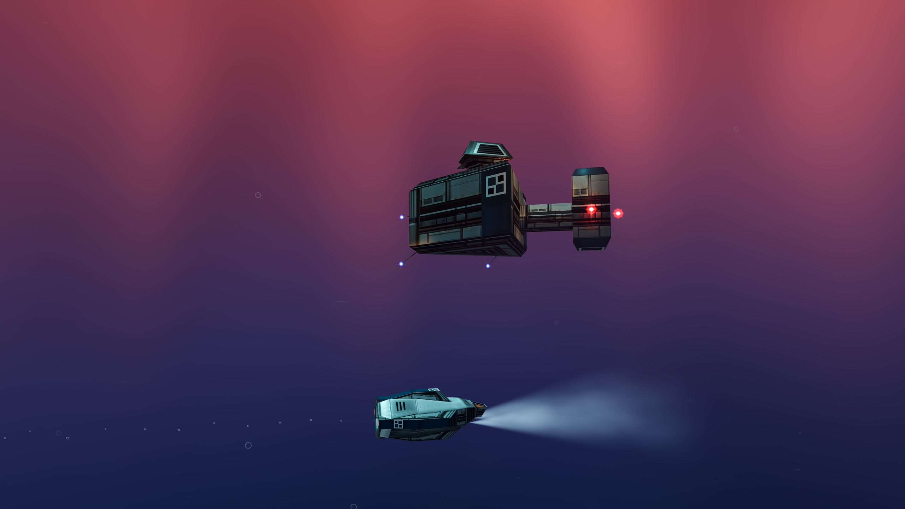
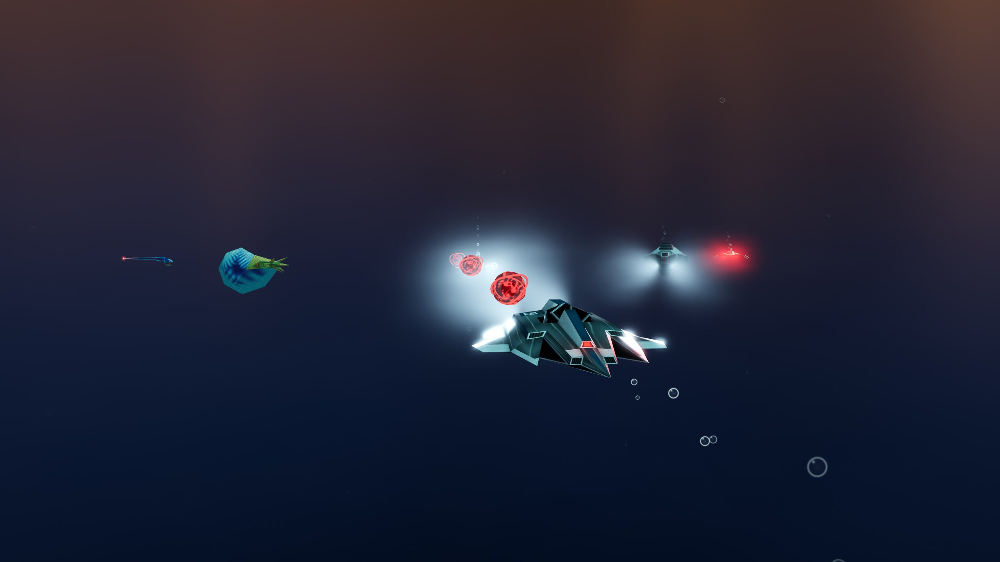

# Abyssal


Play **DEEP** as a modern desktop or browser game, using your own copy of the original.

Abyssal is a separate game engine, built in Godot, that reads a DEEP JAR you already own and converts it on your own machine. Submarine piloting, stations, trading, missions and combat run natively, with modern lighting, gamepad and touch support, a readable interface and a world map with autopilot.

> **You need your own copy of DEEP.** No game data ships with this engine - no models, textures, music, sound or interface art. Nothing is downloaded for you. Without your own JAR there is nothing to play.

[](https://www.youtube.com/watch?v=Si5hHvZAoUE)

**[Watch the one-minute trailer on YouTube](https://www.youtube.com/watch?v=Si5hHvZAoUE)**





## Play

**In your browser:** [abyssal.wwworm.com](https://abyssal.wwworm.com/) - nothing to install. Choose your DEEP JAR and it converts in your browser; the JAR is never uploaded. Needs WebGL 2 and a desktop-class browser.

**Download:** [latest release →](https://github.com/TheWWWorm/abyssal/releases)

| Platform | Download | Start |
| --- | --- | --- |
| Windows x86-64 | `…-windows.zip` | `abyssal.exe` |
| Windows on ARM (ARM64) | `…-windows-arm64.zip` | `abyssal.exe` |
| Linux x86-64 | `…-linux.tar.gz` | `AbyssalEngine/abyssal.x86_64` |
| Linux ARM64 (AArch64) | `…-linux-arm64.tar.gz` | `AbyssalEngine/abyssal.arm64` |
| macOS Apple Silicon | `…-macos.zip` | `Abyssal.app` |
| Android 8+ (ARM64 / x86-64) | `…-android.apk` | Install the APK, then open **Abyssal** |
| Browser (WebGL 2) | `…-web.zip` | Host it yourself over HTTPS |

1. Extract the **entire** archive and keep the files together.
2. Launch the game and choose your DEEP JAR (or drag it onto the window). Its filename does not matter.
3. Wait for the first conversion to finish. It runs offline and only happens once.

No Godot, Python, Java or Node.js install is needed. On Android, keep Android System WebView enabled and up to date; it runs the offline converter during the first import.

**Reference wiki:** [abyssal.wwworm.com/wiki](https://abyssal.wwworm.com/wiki/) is an illustrated guide to the whole game, in fifteen languages. It contains spoilers; the in-game **Reference** shows only what your save has reached.

### Please note

- **Windows and macOS have never been run on real hardware.** They are unsigned (macOS is not notarized), so the system may warn about or block them. macOS is Apple Silicon only.
- **Linux ARM64 and Windows on ARM** are built but not verified on native hardware.
- **Android** is a sideloaded APK; physical-device performance is not yet verified.
- **The browser build needs a web host.** Opening `index.html` from disk will not work.
- Each release's `VALIDATION.md` records exactly what was tested.

### Which DEEP builds work

The engine is developed against the **Sony Ericsson release of DEEP 1.0.8** (SHA-256 `a247f8a872dda268ed8138086bd0de6d038d7faf7ef31469b0efe3eb54209d26`), but any DEEP MIDlet JAR that stores its data the same way is accepted. Localised builds play in their own language.

| Build | Result |
| --- | --- |
| Sony Ericsson 1.0.8, 1.0.3, 1.0.2 (English, Russian) | Works |
| 1.0.8 Mascot Capsule repacks (Russian, Fishlabs manifest) | Works |
| 1.0.8 with `data/3d/*.m3g` (JSR-184 edition) | Not supported |
| Nokia 1.0.3 | Not supported |

A build that does not fit stops with a message saying what did not match. Saves move between JARs that differ only in text, so you can switch the story's language and keep your progress.

## Saves

The game keeps imported content and saves in your user storage. **Transfer save** (main menu → Load game, pause menu or a station's System menu) exports a small data-only save file to back up or move to another device; it never contains game content.

## Mods

The game reads a `mods` folder you create, either next to the executable or in the user data folder:

- Linux: `~/.local/share/abyssal-engine/mods/`
- Windows: `%APPDATA%\abyssal-engine\mods\`
- macOS: `~/Library/Application Support/abyssal-engine/mods/`

On Android and in the browser, use the title screen's **Mods** page, which can also replace textures and music on desktop. Mods change look and sound only; collision and gameplay use the imported models.

- **Textures:** `mods/textures/deep.png` (ships, stations, objects) and `mods/textures/fx.png` (creatures, algae, effects). Any size, but keep the original atlas layout; pure white or transparent texels are see-through. Optional OpenGL tangent-space normal maps go in `deep.normal.png` and `fx.normal.png`.
- **Music:** `mods/music/intro.ogg` and `mods/music/station.ogg` (OGG Vorbis, MP3 or WAV, up to 64 MiB).
- **Models:** `mods/models/<name>.glb` (or `.gltf`), scaled to the imported model's size. If the file carries animations, the first one loops. Names:
  - Submarines: `u0` to `u10`, in dealer order.
  - Stations: `station_hangar_ve`, `station_hangar_de`, `station_habitat_ve`, `station_habitat_de`, `station_sidehabitat`, `station_starter`, `station_top`, `station_bottom`, `station_engine`, `station_bridge_01`, `station_bridge_02`, `station_cannon`.
  - Creatures: `shark_01`, `shark_02`, `whale_01`, `whale_02`, `marlin_01`, `marlin_02`, `devilfish_01`, `devilfish_02`, `anglerfish_01`, `anglerfish_02`, `squid_01`, `squid_02`, `shrimp_01`, `shrimp_02`, `turtle_01`, `turtle_02`, `gulper_eel`, `jellyfish`, `manta`, `nautilus`, `fish_swarm`, `alga_blue`, `alga_brown`, `alga_gold`, `alga_green`, `alga_red`.
  - Vessels and objects: `tanker1`, `aquar`, `kapsel`, `box`, `biowaste`, `trash`, `mine`, `torpedo`, `pfeil` (the harpoon), `laser_0` to `laser_11` and `laser_aqua` (the shots), `explosion`, `fischtod`, `eclipse`, `limiter_up`, `limiter_down`, `stream` (the gate), `skybox`.

Restart after adding files by hand. A file the game cannot read is logged and the imported asset is used instead.

## Project status and license

The importer recognises a compatible JAR's structure, decodes its resource entries and reads class-file data tables with a **restricted bytecode evaluator**. It never loads or runs original classes in a JVM, and no original bytecode is written to its output. Because it does inspect parts of original method bodies, this is reverse engineering and **not** a clean-room reimplementation. Converted content exists only in your own local cache.

The engine's own source and artwork are licensed under the [Apache License 2.0](LICENSE.md). That grants no rights to the original DEEP game, its JAR or anything converted from it. Third-party components keep their own notices, listed in [THIRD_PARTY_NOTICES.md](THIRD_PARTY_NOTICES.md). Do not redistribute your JAR, converted packs or conversion caches. The name is a working title, not a trademark claim.

## For developers

Requires Godot **4.7 Standard** with matching export templates, and Python 3.10+. Run everything from the repository root and keep builds and game content outside it. Running from source with direct JAR conversion also needs JDK 17+ and FFmpeg.

```sh
# Run from source
python3 tools/run.py --jar /private/path/deep3d.jar --compatibility
# Checks
python3 tools/check.py --cache '/path/printed/by/import' --godot '/path/to/godot'
python3 -m unittest discover -s tests -p 'test_*.py'
python3 tools/audit_provenance.py
# One export (windows, windows-arm64, linux, linux-arm64, macos, web, android)
python3 tools/export_game.py --platform linux --release --output /outside/repo/builds/linux
# All release packages
python3 tools/package_releases.py --version 1.0.0 --output /outside/repo/releases/1.0.0
```

Pass `--godot /path/to/godot` or set `GODOT_PATH` if Godot is not on your PATH. Pinned runtimes are fetched and verified into `~/.cache/abyssal-engine` (override with `ABYSSAL_CACHE_HOME`). No JAR is needed to build.

- **Engine patches.** `engine/godot-4.7/` holds patches for Godot 4.7-stable (commit `5b4e0cb0fd279832bbdd69fed5354d4e5ad26f88`): `station-rendering.patch` (shadow caching), and `nvidia-dlss.patch` plus `amd-fsr-after-nvidia-dlss.patch` (or `amd-fsr.patch` alone) for the Windows Direct3D 12 build with NVIDIA DLSS and AMD FSR 3.1/4. Pass a custom template with `--template`; the Windows vendor build uses `--windows-template`, `--fsr-sdk` and `--streamline`, prepared by `tools/prepare_fsr_sdk.py` and `tools/prepare_streamline.py`. Without them the stock template is used.
- **Android.** Needs Godot's Android build template, JDK 17+ and the Android SDK. Release APKs are signed from `ABYSSAL_ANDROID_KEYSTORE`, `ABYSSAL_ANDROID_KEY_ALIAS` and `ABYSSAL_ANDROID_KEY_PASSWORD`, with `--release --version X.Y.Z --version-code N`.
- **Web hosting.** `public/` is a ready-to-serve web export deployed by `wrangler.toml` and `worker.js`. Refresh it with `tools/prepare_web_host.py --source <web export> --output public`, which splits files over Cloudflare's 25 MiB limit. Test locally with `tools/serve_web.py`.
- **Translations.** Engine text uses `tr("...")` with English keys; catalogs live in `game/native/locale/`. Run `python3 tools/engine_text.py check` after changing text.
- **Source allowlist.** Packaging only includes files listed in `source-manifest.json`; update it when adding or removing source files.

Releases follow [Semantic Versioning 2.0.0](https://semver.org/spec/v2.0.0.html). The public compatibility contract covers loading supported saves and settings, compatible-JAR and portable-pack import, and the documented mod formats and command-line interfaces. Breaking it increments MAJOR; backward-compatible features increment MINOR; fixes increment PATCH. Visual, balance and default-setting changes do not break the contract. Tags use `vMAJOR.MINOR.PATCH`, published versions are immutable, and Android's version code increases independently.

## Donations

If you want to support this development or ones similar to it, you can do it at [ko-fi.com/wwworm](https://ko-fi.com/wwworm). Please only do so if you can afford it, and always be financially responsible. I am grateful for any support given.
